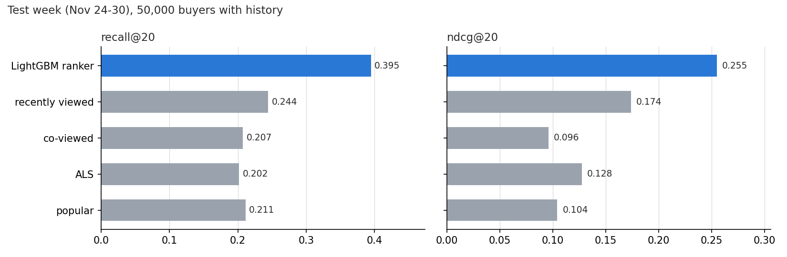
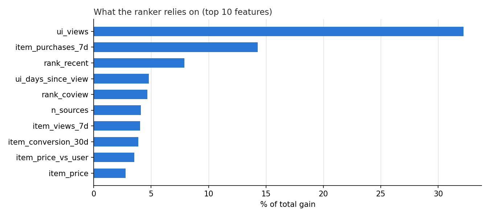
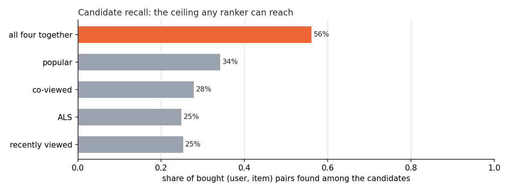

[ 🇺🇸 English ] | [ 🇨🇱 [Leer en Español](README.es.md) ]

# E-commerce Recommender on 85 Million Real Events


A two-stage recommender (candidate generation, then a learning-to-rank model) trained and evaluated offline on two months of real clickstream from a multi-category online store. For 50,000 buyers in the last week of November, **the LightGBM ranker reaches recall@20 of 0.395 against 0.244 for the best single generator**, "what the user recently viewed". The ceiling is set before ranking: **71.4% of what people buy that week is an item they had never viewed before**, and only 56.0% of bought items appear among any generator's candidates.

## Data

[eCommerce behavior data from multi category store](https://www.kaggle.com/datasets/mkechinov/ecommerce-behavior-data-from-multi-category-store) (Kaggle, REES46 / Open CDP), October–November 2019, downloaded on 2026-10-11. **License "copyright-authors"**: the data is not in this repository and is not redistributed; `python -m src.data` downloads it with your own Kaggle token, and only aggregate metrics are published.

The companion project [ecommerce-lakehouse-duckdb](https://github.com/Rxyxs/ecommerce-lakehouse-duckdb) audited this dataset, and two of its findings decide what is used here:

- **Cart events are left out.** Their tracking changes six times in two months, so a model trained on carts would learn the tracking. Only views and purchases are used: 85,290,907 events, 1,384,137 of them purchases.
- **November 14–17 is left out.** Purchases were not recorded for 48 busy hours on those days, so no window is evaluated on missing labels.

## Setup

All splits are by time, never random:

| Window | Dates | Role |
|---|---|---|
| history | Oct 1 – Nov 13 | candidates and features for the ranker's training labels |
| valid | Nov 18 – 23 | labels the ranker is trained on |
| test | Nov 24 – 30 | evaluation only; history for it runs to Nov 23 |

The task: for each user who buys in the test week, rank 20 items so that the ones they buy come first. 105,026 users buy that week; the metrics average over a fixed random sample of 50,000 of those with history (seed 42), and every method is scored on the same users. A user for whom a method has no recommendation counts as zero.

**Candidates** (up to 50 per generator, 152 per user after merging):

- `recent`: items the user viewed in the last 30 days, most recent first.
- `coview`: neighbours of the user's last five items in a session co-view graph of the last 14 days, normalised by the neighbour's popularity.
- `als`: implicit ALS (64 factors) on 30 days of views (weight 1) and purchases (weight 5).
- `popular`: last week's best sellers, overall and in the user's main category.

**Ranker**: LightGBM `lambdarank` on 21 features: the rank and score from each generator, user–item history (views, days since last view, bought before, in last session), item demand (views, purchases and conversion), price relative to the user's usual price, and user activity.

## Results



| Method | recall@20 | hit@20 | NDCG@20 |
|---|---:|---:|---:|
| popular | 0.211 | 0.255 | 0.104 |
| ALS | 0.202 | 0.243 | 0.128 |
| co-viewed | 0.207 | 0.247 | 0.096 |
| recently viewed | 0.244 | 0.293 | 0.174 |
| **LightGBM ranker** | 0.395 | 0.453 | 0.255 |

Over the best single generator, the ranker raises recall@20 by 62% and NDCG@20 by 47%. Each generator alone captures part of the signal; the ranker's job is to decide, per user, which one to trust, and the features it leans on say how:



How many times the user viewed the item (32.2% of the gain) and how much it sold last week (14.3%) carry almost half the model. People buy what they looked at repeatedly and what is selling now. The ALS score, the most complex signal, carries 2.4%.

## The ceiling: most purchases are of items never seen before



Candidate recall is the share of bought (user, item) pairs that appear anywhere among the candidates: no ranker over these candidates can recommend what is not there. All four generators together reach **56.0%**. The reason is the 71.4% above: most items bought in the test week had no view or purchase by that user before the list was made, so no history-based generator could propose them. Improving on that needs signals from the current session (what the user is viewing now), not a better model of the past.

## Users with no history

27.0% of the test week's buyers had no event before November 23. For them the only offline option is last week's best sellers, which gives recall@20 of 0.277 over 28,343 users: higher than the same list for users with history (0.211), because a new buyer's first purchase is more often the store's best-selling phone. A real system would switch to session-based recommendations after the first view; with daily batches that is not something this offline setup can measure.

## What offline metrics cannot say

Recall@20 measures whether the items a user would buy anyway are in the list. It does not measure **incremental** revenue: whether showing the list makes anyone buy something they otherwise would not. That needs an A/B test, which offline logs cannot replace; this repository makes no revenue claim.

## Reproduce

```bash
python -m venv .venv
.venv\Scripts\activate         # Linux/macOS: source .venv/bin/activate
pip install -r requirements.txt

python -m src.data              # Kaggle download (~15 GB of CSV) -> data/events.parquet
python -m src.main              # both stages, about 3 minutes each on an 8-core desktop -> reports/results.json
python -m src.make_figures
pytest                          # metrics and generators on a hand-made fixture
```

`tests/test_readme.py` checks every number in this README against `reports/results.json`.

## Limitations

- The ranker is trained on labels that start four days after its history ends (the Nov 14–17 gap), while the test labels start the day after. That mismatch works against the ranker, so the gap to the baselines is, if anything, understated.
- One test week, which includes Black Friday (Nov 29). Results on a quieter week may differ.
- 50,000 of 105,026 buyers are evaluated, to keep the feature table in memory.
- ALS and the ranker use one seed each; no tuning beyond defaults close to standard values.
